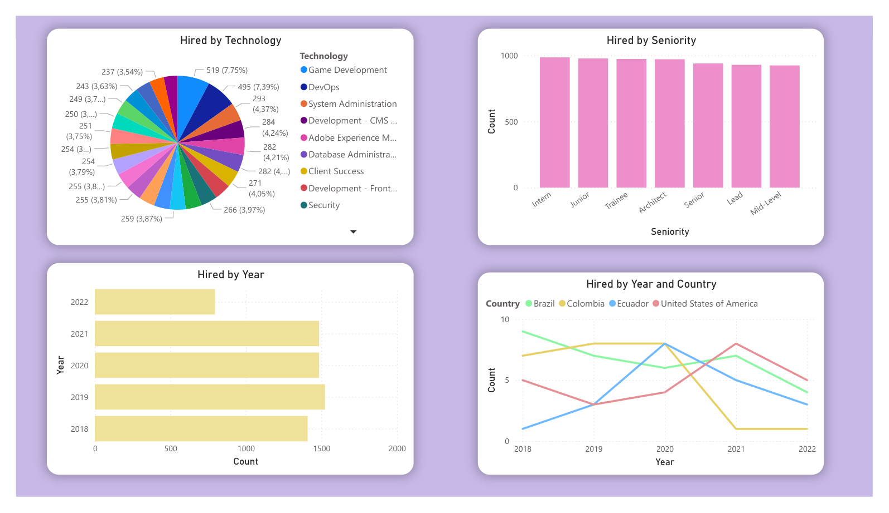

# Recruitment Analytics | Python, PostgreSQL & Power BI

**From raw candidate data to a recruitment dashboard with clearly defined metrics.**

This academic project explores **50,000 synthetic candidate records and 10 original variables**. It combines exploratory data analysis, data preparation, PostgreSQL storage and Power BI reporting. The data is randomly generated; the results illustrate an analytical workflow rather than the performance of a real recruiting organization.

**[View the dashboard PDF](dashboard/Workshop_001_dashboard.pdf)** · [Explore the analysis](notebooks/002_EDA.ipynb) · [Review the transformation](notebooks/003_clean_data_load.ipynb)

*Preview rendered from the dashboard PDF included in this repository.*

## Business questions

- How are candidate records distributed across technologies, countries and seniority levels?
- How do technical assessment scores vary across candidate groups?
- How many candidates meet the project's selection rule, and how are they distributed over time?

## What this project demonstrates

| Stage | Implementation | Evidence |
| --- | --- | --- |
| Ingestion | Load the semicolon-delimited CSV into PostgreSQL | [Raw data notebook](notebooks/001_raw_data_load.ipynb) |
| Exploration | Review distributions, scores, seniority and potential outliers | [EDA notebook](notebooks/002_EDA.ipynb) |
| Preparation | Standardize column names, derive the selection flag and load the clean table | [Transformation notebook](notebooks/003_clean_data_load.ipynb) |
| Reporting | Connect Power BI to PostgreSQL and compare recruitment segments | [Dashboard PDF](dashboard/Workshop_001_dashboard.pdf) |

## Metric definitions and interpretation

The derived **Hired** flag is defined in the transformation notebook:

- **Yes:** Code Challenge Score **>= 7** and Technical Interview Score **>= 7**.
- **No:** at least one score is below 7.

The dashboard reports **counts of candidates meeting that rule** by technology, seniority, year and selected countries. The technology pie chart shows each technology's **share of all selected candidates**, not its within-technology approval rate.

A within-group selection rate would use: selected candidates in the group / all candidates in the same group. Counts, shares and rates answer different questions and should not be used interchangeably. The synthetic selection rule is an exercise definition, not an observed hiring outcome or an automated hiring recommendation.

## Data and tools

The original fields are name, surname, email, country, application date, years of experience, seniority, technology, code challenge score and technical interview score.

**Python:** pandas, NumPy, Matplotlib, Seaborn and SQLAlchemy. **Storage:** PostgreSQL. **Reporting:** Power BI Desktop. **Analysis:** Jupyter notebooks.

## Run the project

### 1. Clone and install

~~~bash
git clone https://github.com/natam226/Workshop_001.git
cd Workshop_001
python -m venv .venv
~~~

Activate the environment:

~~~powershell
# Windows PowerShell
.venv\Scripts\Activate.ps1
~~~

~~~bash
# macOS / Linux
source .venv/bin/activate
~~~

Install dependencies and a notebook interface:

~~~bash
python -m pip install -r requirements.txt
python -m pip install notebook
~~~

### 2. Configure PostgreSQL

Use your own local PostgreSQL instance and create a local **credentials.json** in the repository root:

~~~json
{
  "db_host": "localhost",
  "db_name": "recruitment",
  "db_user": "YOUR_LOCAL_USER",
  "db_password": "YOUR_LOCAL_PASSWORD",
  "db_port": "5432"
}
~~~

Keep credentials outside version control. The current notebooks construct connections using port 5432; adjust the connection cells if your database uses another port.

### 3. Run the notebooks in order

1. [001_raw_data_load.ipynb](notebooks/001_raw_data_load.ipynb)
2. [002_EDA.ipynb](notebooks/002_EDA.ipynb)
3. [003_clean_data_load.ipynb](notebooks/003_clean_data_load.ipynb)

**Working directory:** the current notebook cells use paths such as Workshop_001/credentials.json and Workshop_001/data/candidates.csv. Before running those cells, set the notebook working directory to the folder containing the cloned Workshop_001 repository, or update those input paths for your environment.

The raw table is **candidates_raw_data** and the transformed table is **candidates_clean_data**. Loading cells use replacement mode, so review the destination database before rerunning them.

### 4. Connect Power BI

In Power BI Desktop, choose **Get data → PostgreSQL database**, enter your server and database, authenticate with your local credentials and load the clean table. The PDF in this repository is a static report export; it does not preserve interactive filtering.

## Repository map

~~~text
Workshop_001/
├── dashboard/       # Dashboard PDF and its PNG preview
├── data/            # Synthetic candidates.csv
├── notebooks/       # Ingestion, EDA and clean-data loading
├── requirements.txt
└── README.md
~~~

## Scope

This is a portfolio and learning project. No real hiring impact, causal effect or model fairness evaluation is claimed. Candidate attributes and the derived Hired flag should be interpreted within the synthetic exercise.
